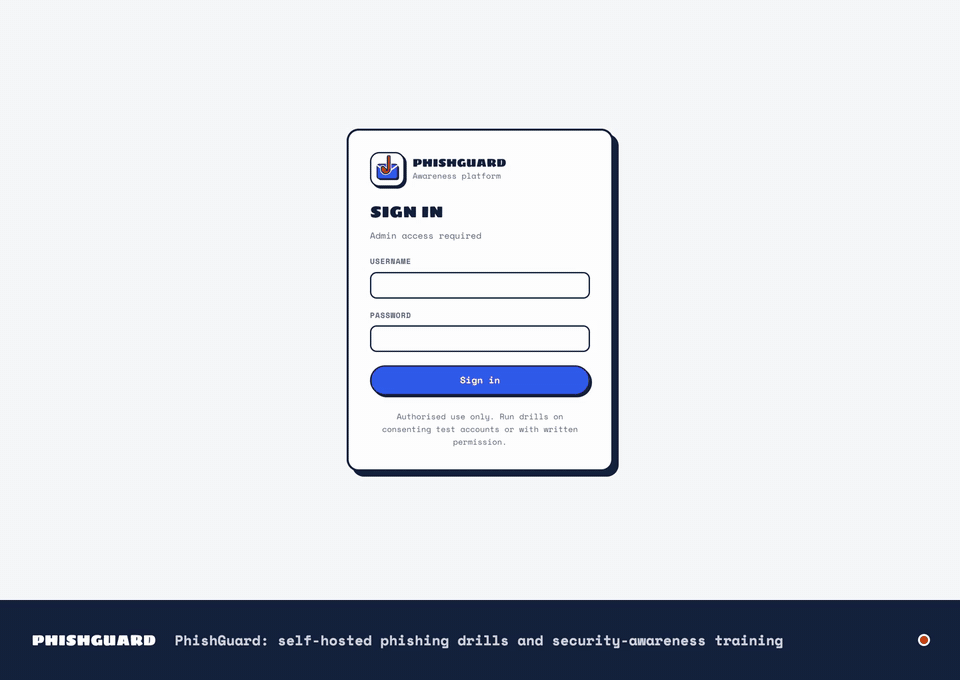
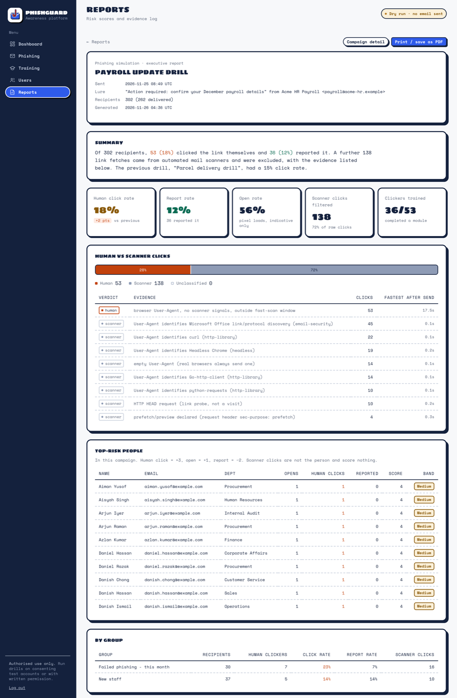
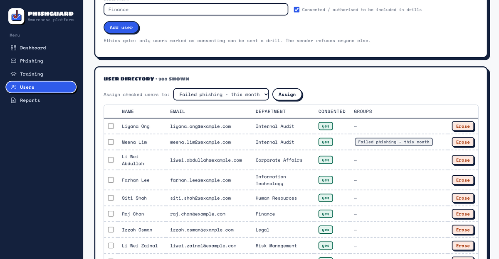
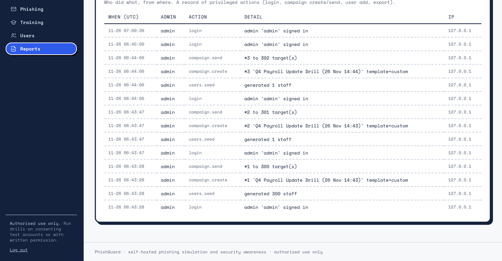
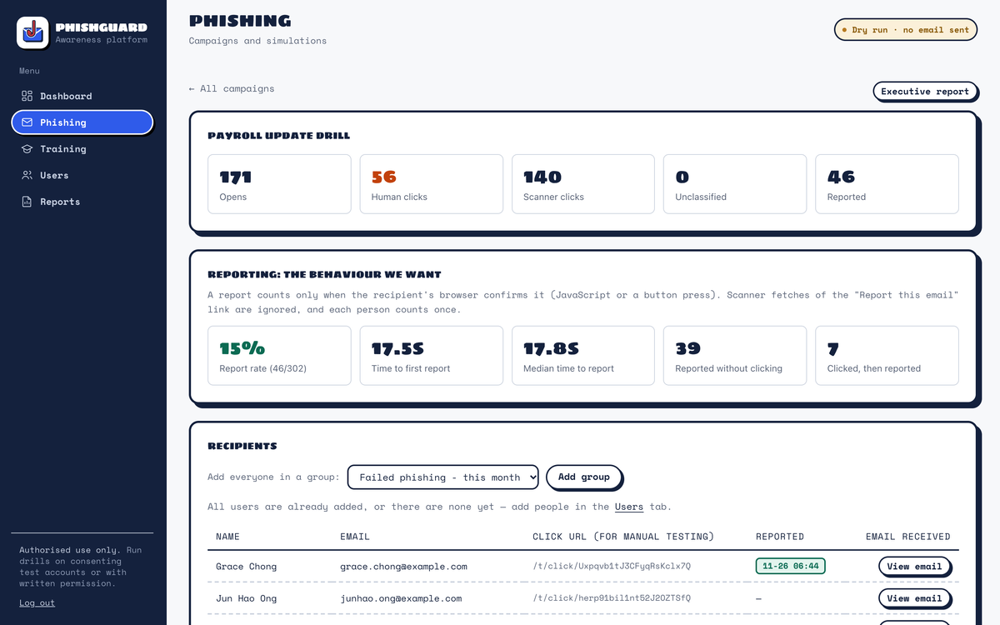
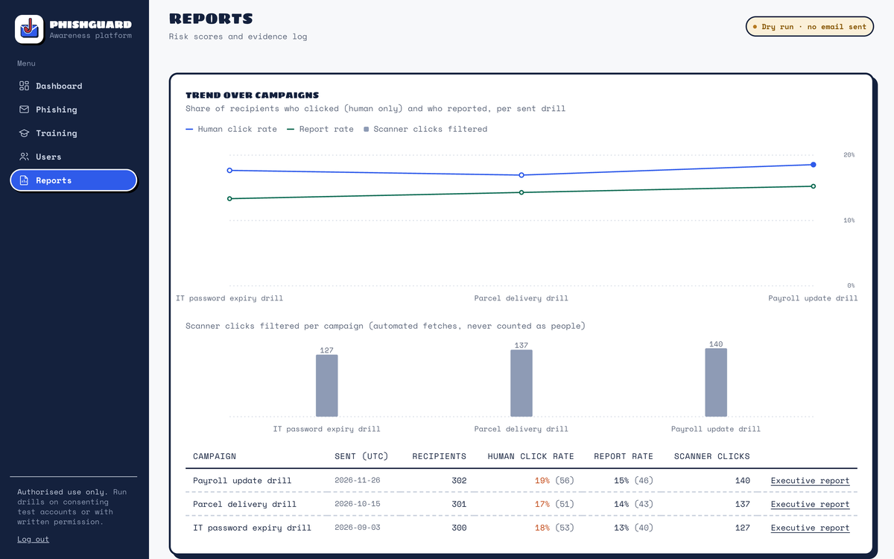
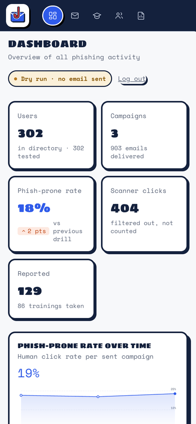

<p align="center"></p>

# PhishGuard

**Self-hosted phishing simulation and security-awareness training that tells a
real human click apart from an automated scanner click, with evidence.**

[](https://github.com/Aidilxiskandar/phishing-awareness-platform/actions/workflows/ci.yml)




<sub>30-second walkthrough on fictional demo data · [MP4 version](docs/demo.mp4)</sub>

## The problem it solves

Mail security gateways (Microsoft Defender Safe Links, Proofpoint, Mimecast,
Barracuda...) and link-preview bots **open every link in an email before a person
ever sees it**. Most phishing tools count those as clicks, so results are inflated
and nobody can prove which clicks were people. A typical outcome: a vendor reports
"1 clicker out of 14" and blames the scanners, staff say otherwise, and the
programme loses credibility.

PhishGuard logs the raw evidence of every interaction (IP, User-Agent, headers,
timing) and classifies it. In the demo drill below, **53 human clicks were
separated from 137 scanner fetches**, and every verdict has a reason an auditor
can read.



## Features

**Phishing simulation**
- Campaigns from a library of drill templates (invoice, password expiry, parcel,
  payroll, MFA alert, CEO request...) with red-flag notes, or fully custom content
- Target individuals or whole staff groups; resumable, never-double-send delivery
- Per-recipient email preview that fires no tracking events
- Dry-run mode (no SMTP needed) for demos and testing

**Click-accuracy engine** ([`app/detection.py`](app/detection.py))
- 45 named scanner families (email security, mail proxies, link previews,
  crawlers, headless browsers, HTTP libraries), matched on product tokens so
  ordinary browsers can't trip them
- Decisive human signal: the landing page's JavaScript beacon (scanners don't run JS)
- Sandbox-aware: self-declared automation (headless UA, prefetch, DevTools
  headers) outranks the JS beacon, because detonation sandboxes do run JS
- Optional operator-declared scanner IP ranges (`SCANNER_NETWORKS`)
- Corporate web-proxy headers (Zscaler, Palo Alto...) never turn a real person into a "scanner"

**Reporting behaviour**
- Every drill email carries a per-recipient "Report this email" link
- Scanner-proof: a fetch shows a confirmation page, and only the browser's
  confirmation records the report, once per person
- Report rate, time to first report, reported-without-clicking metrics

**Training**
- Clickers land on a short awareness page, then a public, token-scoped lesson
  (video + key points + quiz) with no admin login required
- Five CISA "Secure Our World" video modules with quizzes and a pass mark
- Completion tracked per person; self-hosted videos supported (Remotion pipeline in `video/`)

**Reporting and analytics**
- Dashboard: phish-prone trend, risk distribution, engagement funnel, click accuracy
- Reports: trend across campaigns, breakdown by staff group, per-person risk scores
- Print-ready executive report per campaign (Save as PDF) with plain-language recommendations
- Full evidence log and CSV export

**Privacy and governance**
- Consent gate enforced in code: the sender refuses non-consenting recipients
- Recipient domain allow-list for real sends
- Evidence retention purge (`RETENTION_DAYS`) and right-to-erasure (GDPR Art. 17 / PDPA)
  that anonymises a person everywhere while keeping campaign totals correct
- Audit log of admin actions

<p>
  
  
</p>
<p><sub>Left: consent gate and per-person right-to-erasure. Right: the audit trail of every admin action.</sub></p>

**More screens**

<p>
  
  
</p>
<p align="center"><br><sub>Works on phones too.</sub></p>

## Security

PhishGuard holds staff PII and click evidence, so the admin surface is hardened:

- Deny-by-default authentication; only recipient tracking endpoints are public
- Per-session CSRF tokens on every form plus an Origin check
- Login lockout after 5 failures; sessions rotated on login, revoked on logout,
  8-hour absolute lifetime; `__Host-` secure cookie in production
- Nonce-based Content-Security-Policy (no inline script), sandboxed email previews,
  HSTS, `no-store` on admin pages
- Evidence-log IPs can't be forged: `X-Forwarded-For` is honoured only from trusted proxies
- Production refuses to start without a secret key, admin password and SMTP

## Quick start

```bash
python3 -m venv .venv && source .venv/bin/activate
pip install -r requirements.txt
uvicorn app.main:app --reload        # http://127.0.0.1:8000  (admin / phishguard-dev)
```

With no SMTP configured the app runs in **dry-run mode**: sending a drill prints
each email and its tracking links to the console.

**See the engine work in 2 minutes:** add yourself as a consenting user, create a
campaign, send it, then open your click link in a browser (logged as **human**)
and `curl` the same link (logged as **scanner**).

**Full demo data:** start a throwaway server and run the drill simulator, which
generates 300 staff, a campaign, scanner prefetches and realistic human behaviour:

```bash
DATABASE_URL=sqlite:///demo.db TRUSTED_PROXIES=127.0.0.1 uvicorn app.main:app --port 8765
python scripts/simulate_drill.py --db demo.db
```

## Deploy

```bash
cp .env.example .env     # set DOMAIN, BASE_URL, SECRET_KEY, ADMIN_PASSWORD, SMTP_*
docker compose -f docker-compose.prod.yml up -d --build
```

Caddy obtains a TLS certificate automatically; the app runs read-only and
non-root on an internal network and migrates its database on start. The
**[deployment guide](docs/DEPLOYMENT.md)** covers prerequisites, configuration,
a 5-minute verification drill, backups, retention and upgrades.

For a local trial: `docker compose up --build` (dev mode, dry-run email).

## Quality

```bash
pip install -r requirements-dev.txt
make test                    # 194 tests, 95% coverage (CI enforces >= 85%)
make lint                    # ruff
node scripts/browser_smoke.mjs http://127.0.0.1:8765   # real-browser end-to-end
```

- Property-based tests (Hypothesis) on the detection engine's invariants
- A dependency-free headless-Chrome smoke test drives the full drill (login,
  campaign, send, human click, report, staff training, every tab) and fails on any
  HTTP error, CSP violation or JS error; it runs in CI on every push
- `pip-audit` dependency scan in CI

## Architecture

```
app/
  main.py          app factory: middleware (auth, CSRF, headers), routers
  routers/         auth, dashboard, phishing, users, training, reports, tracking
  services/        risk, analytics, reporting, email templates, erasure, charts, video
  detection.py     click-accuracy engine (pure function, no I/O)
  security.py      sessions, CSRF, throttling, client IP, security headers
alembic/           schema migrations (app.migrate handles fresh / legacy / managed DBs)
scripts/           drill simulator, browser smoke test
video/             Remotion source for self-hosted training animations
```

Python 3.12 · FastAPI · SQLModel (SQLite, WAL) · Jinja2 · Alembic. Server-rendered
with no frontend build step; charts are inline SVG.

## Ethics

PhishGuard is dual-use. **Run it only against consenting test accounts or with
written authorisation from the organisation.** The consent gate and domain
allow-list are enforced in code, but authorisation is the operator's
responsibility. See [LICENSE](LICENSE).

## Roadmap

CSV import of staff, scheduled and recurring campaigns, automatic training
assignment after a click, SSO (OIDC) for admins, multi-admin roles.

See [CHANGELOG.md](CHANGELOG.md) for release history.
